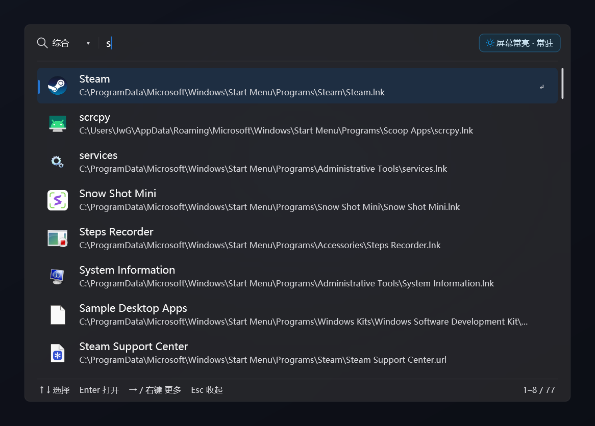
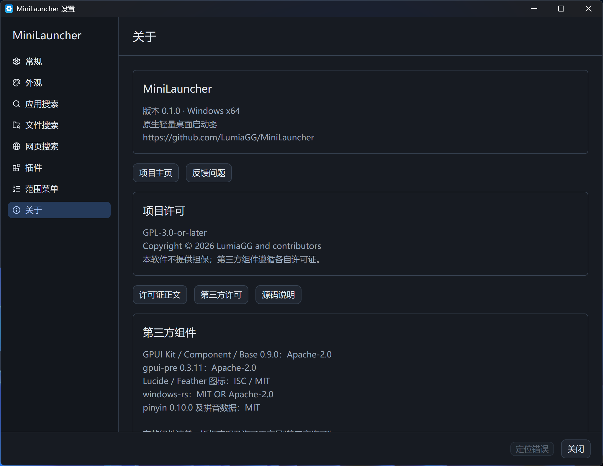

# MiniLauncher

面向 Windows 10/11 的原生轻量桌面启动器。纯 Rust + Win32 实现，不包含任何浏览器渲染引擎。

<p align="center">
  
  
  
  
  
</p>

<p align="center">
  
</p>

---

## 设计原则

MiniLauncher 面向对常驻开销、唤出响应与系统集成度有明确要求的用户场景：

- **拒绝渲染层冗余**：不引入 Chromium、WebView 或任何 Web 运行时，避免常驻进程动辄占用数百兆内存与不可控的垃圾回收停顿。
- **原生显示管线**：窗口基于 Direct2D、DirectWrite 与 DirectComposition 自绘，原生支持 Windows 11 DWM 阴影、圆角、系统强调色以及 Mica（云母）/ Acrylic（亚克力）材质。
- **输入法原生接管**：文本输入完全依托系统 IMM32 管理候选窗口与组合输入，消除非原生文本框常见的候选错位与文字彩边。
- **配置按需分离**：图形化设置管理器作为独立的轻量进程按需启动，关闭即释放，主搜索进程不驻留多余的 UI 框架。

---

## 核心功能

### 本地检索与交互
- **拼音与模糊匹配**：索引开始菜单、桌面及 Windows 应用目录（包含商店应用），支持应用全名、汉字、拼音全拼、拼音首字母模糊匹配。
- **应用结果管理**：在设置的“应用搜索”页统一管理应用别名、已置顶和已移除的应用，修改后自动保存并生效。
- **Everything IPC 直连**：通过只读 IPC 与本机 Everything 客户端无缝对接，实现全盘毫秒级文件与目录检索。
- **原生拖拽 (OLE Drag & Drop)**：搜索出的文件、应用可直接按住左键拖拽至桌面、资源管理器或其他第三方窗口。
- **即时计算器**：直接在输入框键入数学表达式（如 `(1024 + 512) * 8`），实时求值，回车直接复制。
- **DPI 动态感知**：按鼠标所在显示器呼出，窗口缩放、字体清晰度与行高随系统 DPI 实时重绘。

<p align="center">
  
</p>

### 插件与扩展生态
插件采用独立进程架构，通过标准 **JSON-RPC 2.0** 协议与宿主通信，异常退出或超时均自动回收，绝不拖垮宿主进程：

| 扩展功能 | 触发方式 | 说明 |
| :--- | :--- | :--- |
| **[Piin 备注](plugins/piin/README.md)** | `piin` / `note` / `Ctrl+Alt+N` | 手动保存文本和图片，支持置顶、检索、预览、拖出；输入框支持粘贴图片 |
| **[剪贴板历史](plugins/clipboard-history/README.md)** | 空输入 / `clip` / `Ctrl+Alt+V` | 记录文本与无损图片，支持缩略图与空格键大图预览，支持原生拖出 |
| **[两步验证码 (TOTP)](plugins/two-factor/README.md)** | `2fa` | 快速检索并生成 TOTP 验证码，回车复制；本地凭据采用 Windows DPAPI 加密 |
| **[路径打开](plugins/path-opener/README.md)** | 直接输入路径 / `path` | 智能识别本地路径、环境变量与 `file://` 地址并打开所在目录或文件 |
| **[防休眠](plugins/caffeine/README.md)** | `caf` / `caffeine` / `awake` | 保持屏幕常亮或仅防系统睡眠，支持定时关闭与托盘管理 |
| **[进程与端口管理](plugins/process-killer/README.md)** | `port` / `kill` / `ps` | 查询端口占用、进程内存及路径，支持强制终止进程 |

网络搜索是宿主内置功能，输入 `g` / `bing` 加关键词即可调用默认浏览器。上述自带插件的详细用法、默认配置和构建安装步骤见各自 README。

翻译与 WorkspaceHub 集成由独立的 `MiniLauncher.plugs` 第三方插件项目提供，通过插件管理页按需安装，不随宿主构建或预装。

---

## 图形设置管理器

输入 `>settings` 或通过托盘右键菜单即可唤出设置界面。

<p align="center">
  
</p>

- **设置进程隔离**：基于轻量级 GPUI Kit 构建，仅在打开设置时启动，关闭窗口后完整退出，主搜索进程零多余负担。
- **柔和明暗主题**：设置窗口使用分层的浅灰白与炭灰配色，插件安装、卸载确认框跟随主题并显示在设置窗口内。
- **绿色便携模式**：默认将配置文件、使用记录及插件统一部署于程序同级 `data/` 目录，移动安装目录即可带走全部环境与数据。
- **数据目录入口**：常规设置显示当前配置所在的数据目录，可点击“打开目录”直接访问；切换便携模式后，重启完成迁移再使用新目录。
- **全新安装隔离**：新的便携安装从默认配置开始，不自动导入 `%APPDATA%\MiniLauncher` 中的个人数据；覆盖升级保留安装目录中已有数据，主动切换便携模式时才迁移。
- **热重载支持**：修改后自动保存，配置自动应用至运行中的宿主，无需重启。
- **设置校验与筛选**：错误显示在对应字段旁，可定位并修正错误；其他有效字段继续自动保存。插件支持名称、关键词及启用状态筛选，已置顶和已移除应用支持名称、路径、搜索词筛选，应用名称在后台加载并缓存。
- **搜索反馈**：底栏按实际动作提示打开、运行、复制或粘贴；点击状态信息可查看详情、复制完整信息、重试或进入设置。空结果提供重试和范围切换入口；长范围名称自动适配，悬停可查看完整名称及结果路径，普通结果标题高亮直接匹配的文字。
- **关于页**：查看版本、项目主页、问题反馈、主要第三方组件及许可说明。

---

## 常用操作

| 操作 | 快捷键 / 交互 | 说明 |
| :--- | :--- | :--- |
| **唤出 / 收起** | `Alt + Space` | 全局快捷键，随鼠标所在屏幕显示；失去焦点或再次按键自动收起 |
| **返回 / 取消** | `Esc` | 清空搜索、退出子层级或收起窗口 |
| **导航与执行** | `↑` / `↓` / `Tab` 挑选，`Enter` 启动 | 纯键盘操作，选中项随按键平滑平移 |
| **操作上下文** | `Shift + F10` / `→` / 右键 | 打开项目菜单（管理员运行、打开目录、关键词置顶、从列表移除） |
| **切换搜索范围** | 长按 `Alt` + 方向键 | 切换综合、文件、网页及已启用的插件范围；默认使用 `Alt+1/2/3`，可在设置 → 范围菜单中为各来源配置 `Alt+0–9`，留空禁用；仅在启动器内生效 |
| **大图预览** | 选中图片项按 `Space` | 查看剪贴板图片原图，按空格或 Esc 退出 |
| **搜索反馈 / 重试** | `Ctrl+Shift+I` / `Ctrl+R` | 有状态信息时打开详情操作菜单；空结果或错误状态下重试当前搜索，支持重试的文本面板沿用原快捷键 |

---

## 安装与运行

### 快速安装
- **图形安装包**：下载并运行 `MiniLauncher-Setup-windows-x64.exe`，支持自由指定安装路径、创建开始菜单与桌面快捷方式、默认便携模式（数据保留于安装目录同级 `data/`），并自动集成至 Windows“应用和功能”卸载管理。
- **便携压缩包**：解压 `MiniLauncher-Portable-windows-x64.zip` 至任意具备写权限的目录，直接运行 `mini-launcher.exe`。
- **开机自启**：默认无需管理员权限；在设置管理器中开启“开机启动”即可写入当前用户自启项。

### 快捷唤出
使用全局快捷键 `Alt + Space` 即可随鼠标位置即时唤出主启动条。

唤出快捷键也支持同键双击：在设置中选择双击 Ctrl、Alt、Shift、Win，或直接填写 `Ctrl+Ctrl`、`Space+Space`、`A+A`、`F1+F1` 等。两次按下间隔最多 350ms，每次按住最多 250ms，在第二次松开时触发；左右修饰键均支持，但两次须为同一侧。长按、穿插其他按键或鼠标点击不会触发。双击保留原按键行为，因此 Win 可能打开开始菜单、Shift 可能切换输入法、字母仍会输入；无法检测其他软件是否也使用相同双击。

### 本地构建
环境依赖：Windows 10/11 x64、Rust MSVC 工具链、Visual Studio C++ Build Tools。

```powershell
# 运行 Release 编译版本（自动退出旧实例）
.\dev.ps1 run -Release

# 编译包含宿主、设置程序、插件与单文件安装器的完整发行包
.\scripts\build-release.ps1

# 执行编译检查
.\dev.ps1 check
```

普通 Cargo 命令、`dev.ps1` 和 `scripts/` 使用同一套构建目录：

| 目录 | 用途 |
| :--- | :--- |
| `target/debug/` | Debug 编译产物与缓存 |
| `target/release/` | Release 编译产物与缓存（含插件、设置程序和安装器） |
| `target/packages/` | 完整发行包、校验文件及 `unpacked/` 可运行目录 |
| `target/package-staging/` | 打包临时目录，每次打包结束自动清理本次目录 |
| `target/test-fixtures/` | 测试辅助程序的编译输出 |
| `artifacts/` | 测试报告、截图和隔离测试数据 |

发行构建使用原生 Windows x64 MSVC 工具链，不再指定 `--target` 或使用独立的
`target/distribution/` 缓存。构建前自动关闭从 `target/release/` 运行的程序，避免文件占用。
`build-release.ps1` 和 `restart-test-build.ps1` 的 `-OutputDirectory` 仍可自定义发行包位置，
不影响编译目录；`reinstall-plugins.ps1` 默认安装位置同步为 `target/packages/unpacked/MiniLauncher/`。

旧的 `artifacts/release/` 和 `target/distribution/` 不会自动删除或迁移。若旧发行目录
已用于日常运行，可继续通过 `-InstallDirectory` 指向它，保留原有数据；切换到新目录前
请先保留旧目录中的 `data/` 和 `portable.toml`。

---

## 开源协议

本项目采用 **GPL-3.0-or-later**，完整条款见 [LICENSE](LICENSE)，版权及授权声明见 [COPYRIGHT](COPYRIGHT)。

第三方组件保留各自许可，详见 [THIRD_PARTY_NOTICES.html](THIRD_PARTY_NOTICES.html) 和[依赖清单](docs/dependency-licenses.csv)。设置 → 关于支持离线查看许可。

完整对应源码与构建脚本通过主发行说明中的独立源码下载链接提供。构建及分发要求见 [SOURCE_BUILD.md](SOURCE_BUILD.md)。
